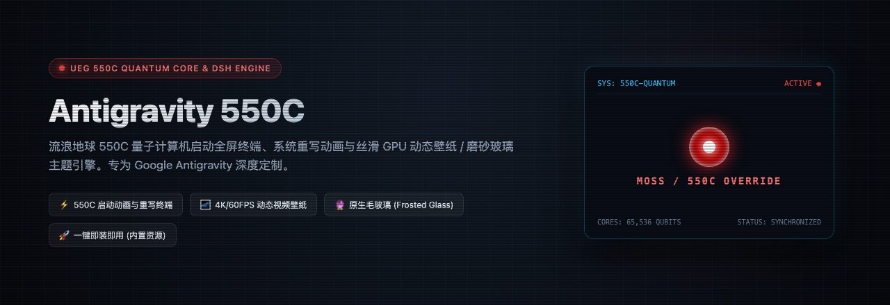
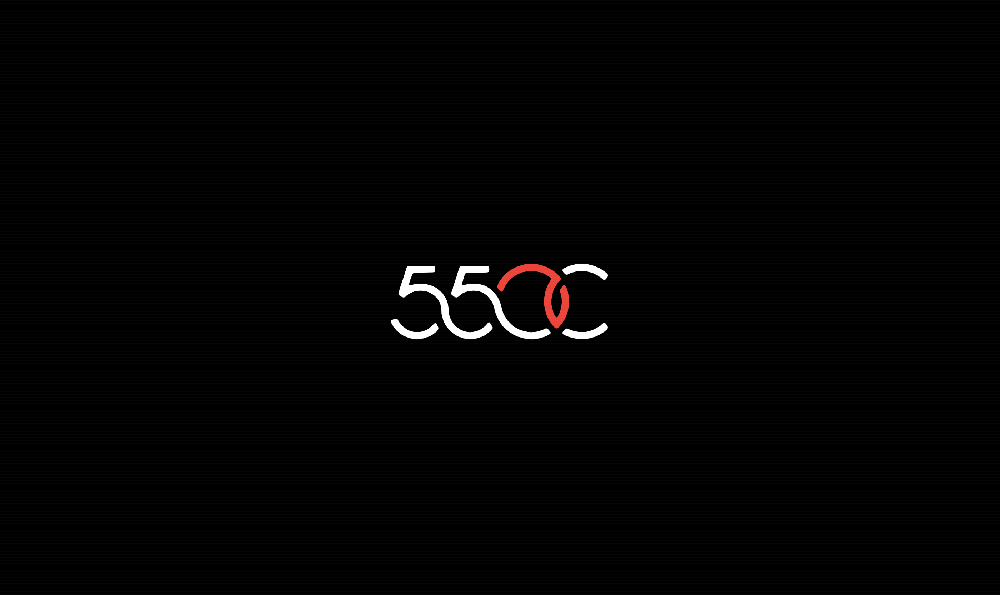
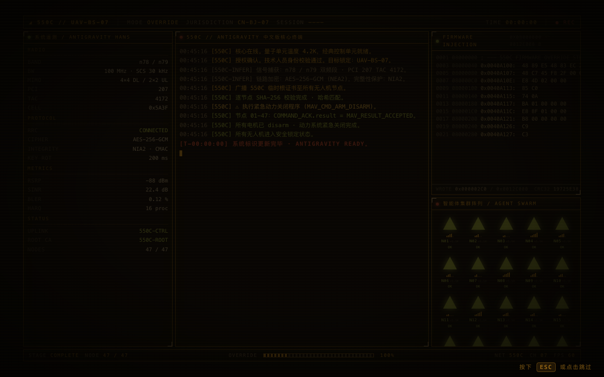
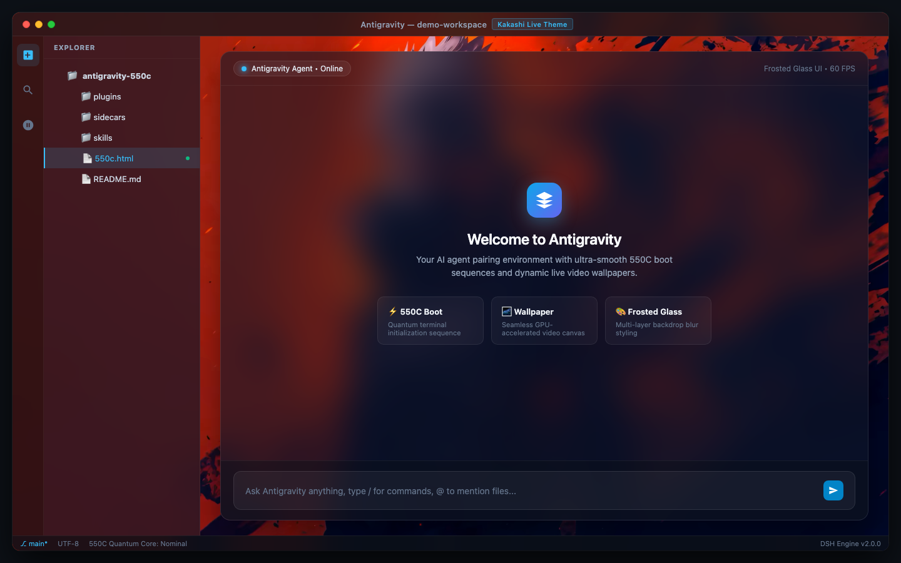
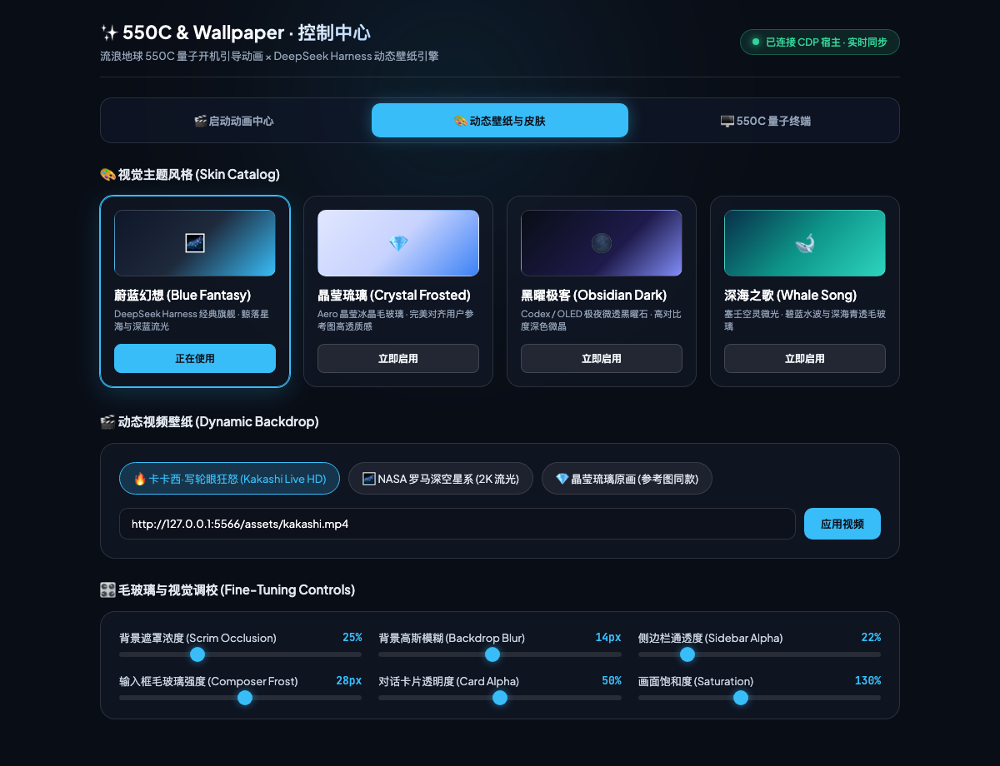
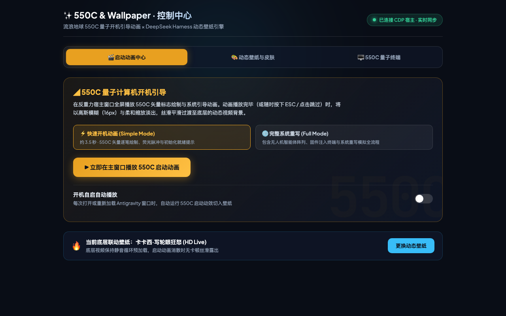

<p align="center">
  
</p>

# 🚀 Antigravity 550C

<p align="center">
  <b>流浪地球 550C 量子计算机启动全屏终端、系统重写动画与 4K/60FPS 动态视频壁纸毛玻璃引擎</b><br/>
  <i>Wandering Earth 550C Quantum Boot Terminal & Dynamic Video Wallpaper Engine for Google Antigravity</i>
</p>

<p align="center">
  <a href="https://github.com/bl4346324-alt/antigravity-550c/releases"></a>
  <a href="#"></a>
  <a href="#"></a>
  <a href="LICENSE"></a>
  <a href="#"></a>
</p>

<p align="center">
  <a href="#-效果预览">✨ 效果预览</a> •
  <a href="#-打动人心的细节设计">💡 核心细节</a> •
  <a href="#-资源包含说明">🎁 资源包含说明</a> •
  <a href="#-快速安装">📦 快速安装</a> •
  <a href="#-使用指南">🎮 使用指南</a> •
  <a href="#-常见问题-faq">❓ 常见问题</a> •
  <a href="#-开源协议与致谢">📄 开源协议</a>
</p>

---

## ✨ 效果预览

<table>
  <tr>
    <td width="50%" align="center">
      <b>⚡ 550C 电影级矢量描摹与开机引导</b><br/><br/>
      
    </td>
    <td width="50%" align="center">
      <b>🛰️ 550C 量子终端覆写与 47 节点拓扑</b><br/><br/>
      
    </td>
  </tr>
  <tr>
    <td width="50%" align="center">
      <b>🌌 卡卡西 2K 动态视频壁纸与毛玻璃工作区</b><br/><br/>
      
    </td>
    <td width="50%" align="center">
      <b>🎨 DSH 动态壁纸与 4 款毛玻璃皮肤控制台</b><br/><br/>
      
    </td>
  </tr>
  <tr>
    <td colspan="2" align="center">
      <b>🎛️ 550C 启动动画侧边栏独立交互与回放控制台</b><br/><br/>
      
    </td>
  </tr>
</table>

---

## 💡 打动人心的细节设计

- 🎬 **完整 16 秒 550C 量子计算机开机覆写叙事**：
  - **开机矢量描绘**：纯黑背景上 550C 矢量标志逐路径笔画描边书写、红色量子核心发光脉冲呼吸、开机文本打字显现；
  - **量子终端展开**：标志平滑展开至量子控制终端，高精度时钟、系统遥测参数与 47 个无人机/智能体 swarm 节点逐点覆写变绿；
  - **基站接入与紧急指令**：基站接入授权弹窗、双频链路监控波形与动力切断指令；
  - **终幕覆写通告**：中央金色通告 `SYSTEM IS REWRITTEN · ANTIGRAVITY READY` 闪耀呈现。
- ⚡ **0.7 秒电影级平滑交叉溶解（Cross-Dissolve）**：
  - 550C 终幕通告完毕后，全屏启动图层以 `cubic-bezier(0.16, 1, 0.3, 1)` 渐变淡出；
  - 与后台动态壁纸无缝叠化流转，**告别任何灰屏、白屏或闪烁**。
- 🛡️ **双向就绪握手（Handshake Guard）**：
  - 内置常驻守护进程检测 `/api/wallpaper-ready`；
  - 确保壁纸首帧完成 GPU 解码并准备就绪后，才触发流转切换，保证视觉体验如丝般顺滑。
- 🔮 **原生 GPU 硬件加速 & 毛玻璃（Frosted Glass）**：
  - 动态视频壁纸在底层独立图层静默循环播放；
  - 侧边栏、对话框及输入区域均采用高透多层 `backdrop-filter: blur(28px)` 玻璃拟态渲染，兼顾极客科幻感与代码可读性。
- ⚡ **随时随地即时跳过**：
  - 在开机动画播放途中，随时按下键盘 <kbd>Esc</kbd> 或鼠标轻点任意位置，即可立刻溶解切入壁纸工作区。
- 🧠 **会话内单次播放记忆**：
  - 仅在首次打开 Antigravity 时呈现开机仪式感；
  - 会话中切换项目、打开新对话绝不打扰正常开发工作。

---

## 🎁 资源包含说明

> [!IMPORTANT]
> **本插件开箱即用，所有开机动画和动态壁纸资源均已完整内置在仓库中，无需用户单独下载或手动导入！**

| 资源类别 | 包含内容 | 存储位置 | 状态 |
| :--- | :--- | :--- | :--- |
| **550C 量子开机动画** | 矢量 SVG 描边动画、CRT 扫描线、47 节点拓扑、量子重写终端 | `550c.html` / `plugins/antigravity-550c/sidecars/terminal/` | ✅ **内置** |
| **火影忍者卡卡西壁纸** | 2K 60FPS 写轮眼与雷切动态视频壁纸（超轻量 GPU 硬解） | `plugins/antigravity-550c/sidecars/controller/assets/kakashi.mp4` | ✅ **内置** |
| **深空银河壁纸** | NASA 高清浩瀚星系与宇宙星尘动态壁纸 | `plugins/antigravity-550c/sidecars/controller/assets/nasa_galaxies.webm` | ✅ **内置** |
| **4 款毛玻璃皮肤预设** | 蔚蓝幻想 (Azure)、晶莹琉璃 (Crystal)、深海之歌 (Deep Ocean)、黑曜极客 (Obsidian) | `plugins/antigravity-550c/skins/` | ✅ **内置** |

> [!TIP]
> **想要使用自己的专属壁纸？**
> 本插件同样支持自定义扩展！您只需在 DSH 皮肤中心控制台（`/wallpaper`）中点击上传或将视频放置于资源目录，即可随时切换为您喜欢的动态壁纸。

---

## 📦 快速安装

本项目提供三种安装方式，推荐使用 **方式一（一键脚本）**：

### 方式一：一键全自动安装（推荐）

打开 macOS 终端，执行以下命令即可全自动安装、配置守护进程并集成启动入口：

```bash
curl -fsSL https://raw.githubusercontent.com/bl4346324-alt/antigravity-550c/main/install.sh | bash
```

安装脚本会自动处理：
1. 下载并安装插件包至全局插件目录：`~/.gemini/config/plugins/antigravity-550c/`；
2. 自动通过本地 Connect RPC 向 Antigravity 语言服务发送激活指令，**无需重启 IDE 即可实时生效**；
3. 配置并启动常驻后台守护服务（`LaunchAgent`），保障壁纸流与启动握手；
4. 自动将 550C 引导启动器注入至 `/Applications/Antigravity 中文.app` 与 `/Applications/Antigravity 550C.app`。

---

### 方式二：Git 克隆安装

如果您喜欢通过 Git 进行版本管理：

```bash
# 1. 克隆代码仓库到本地
git clone https://github.com/bl4346324-alt/antigravity-550c.git
cd antigravity-550c

# 2. 赋予执行权限并运行安装
chmod +x install.sh
./install.sh
```

---

### 方式三：在 Antigravity 聊天框中让 AI 助手一键安装

如果您当前正在使用 Antigravity 进行开发，只需在对话输入框中发送：

```text
帮我安装并启用 antigravity-550c 插件
```

AI 助手将自动通过内置的 `plugin` 技能完成目录解压、配置注册与热生效。

---

## 🎮 使用指南

### 1. 点击图标享受开机仪式感
- 启动 **Antigravity 中文.app** 或 **Antigravity 550C.app**；
- 屏幕中央立即全屏呈现 550C 量子计算机开机动画；
- 16 秒动画播完（或按下 <kbd>Esc</kbd> 跳过）后自动平滑溶解，无缝切入卡卡西动态壁纸工作区！

### 2. 随时回放 550C 量子终端
- 在聊天框中发送斜杠指令或文字：
  ```
  /550c
  ```
- 或在对话中点击链接直接打开侧边栏独立面板：
  - [打开 550C 量子重写终端](sidecar://antigravity-550c/terminal/)

### 3. 打开动态视频壁纸与皮肤中心
- 在聊天框中发送：
  ```
  /wallpaper
  ```
- 或点击链接打开毛玻璃控制面板：
  - [打开 DSH 皮肤与壁纸控制中心](sidecar://antigravity-550c/controller/)
- 在控制台中您可以：
  - 自由调节毛玻璃不透明度 (Opacity)、模糊半径 (Blur) 与色彩饱和度 (Saturate)；
  - 实时切换 4 款主题皮肤并自动持久化存储。

---

## ❓ 常见问题 (FAQ)

<details>
<summary><b>Q1: 开局动画播放完毕后为什么能无缝切入壁纸？</b></summary>
<br/>
插件采用了类似电影视效的 <b>双层画卷叠化设计</b>：底层由守护进程在应用开启瞬间预加载动态壁纸并解码首帧；上层为 550C 全屏独立量子终端。当倒计时完毕或收到 <code>/api/wallpaper-ready</code> 握手信号后，上层触发 CSS <code>opacity: 0</code> 的 700ms 交叉溶解动画，从而实现零黑屏、零灰屏的平滑视觉过渡。
</details>

<details>
<summary><b>Q2: 动态视频壁纸会占用很多 CPU / 内存资源吗？</b></summary>
<br/>
不会。卡卡西壁纸与银河壁纸均针对 Apple Silicon / Intel 平台进行了深度编码优化，支持原生 <b>VideoToolbox 硬件硬解</b>。在后台播放时 CPU 占用通常小于 1%，内存增量极小，完全不影响正常的代码编译与大模型推理任务。
</details>

<details>
<summary><b>Q3: 我可以换成自己喜欢的视频壁纸吗？</b></summary>
<br/>
可以！您只需要打开壁纸控制面板（发送 <code>/wallpaper</code> 或访问 <code>sidecar://antigravity-550c/controller/</code>），在控制台中即可选择本地 MP4/WebM 视频或高保真图片作为新壁纸。
</details>

<details>
<summary><b>Q4: 切换到新对话或新项目时会重复播放 550C 动画吗？</b></summary>
<br/>
不会。插件内置了生命周期状态机，仅在 Antigravity 首次冷启动时呈现仪式感引导；在 IDE 内部切换标签页、创建新会话或重载窗口时，均会自动跳过动画并直接呈现当前壁纸。
</details>

<details>
<summary><b>Q5: 如何卸载或暂时禁用插件？</b></summary>
<br/>
如需临时禁用，在对话框输入 <code>/wallpaper</code> 并将开关切为关即可；如需彻底移除，删除 <code>~/.gemini/config/plugins/antigravity-550c</code> 目录并卸载 LaunchAgent 即可。
</details>

---

## 🛠️ 从源码构建 (开发人员)

如果您希望自行定制 Objective-C 启动器源码或动画效果：

```bash
# 赋予构建权限并执行编译打包
chmod +x build.sh
./build.sh
```

构建脚本会自动：
1. 组装更新启动器与 Sidecar 终端页面；
2. 使用 `clang` 编译原生 arm64 启动器二进制 `Antigravity550C`；
3. 更新打包 `Antigravity 550C.app` 并完成 Ad-hoc 代码签名。

---

## 📁 项目目录结构

```
antigravity-550c/
├── docs/
│   └── assets/                           # 📸 无个人隐私数据的专业效果截图
│       ├── hero.png                      # 顶部 Hero 展示横幅
│       ├── boot-screen.png               # 550C 开机矢量描边截图
│       ├── terminal.png                  # 550C 量子终端覆写截图
│       ├── workspace-kakashi.png         # 卡卡西壁纸与毛玻璃工作区截图
│       ├── wallpaper-center.png          # DSH 皮肤控制台截图
│       └── boot-controls.png             # 侧边栏启动控制截图
├── Antigravity 550C.app/                 # 🚀 macOS 原生启动器应用包
│   └── Contents/
│       ├── MacOS/Antigravity550C         # 原生可执行文件 (Mach-O arm64)
│       └── Resources/                    # 550c.html 页面与 AppIcon.icns
├── plugins/antigravity-550c/             # 🧩 Antigravity 内置插件包
│   ├── plugin.json                       # 插件清单 (Manifest)
│   ├── skills/
│   │   ├── 550c/SKILL.md                 # /550c 终端技能定义
│   │   └── wallpaper/SKILL.md            # /wallpaper 壁纸皮肤中心技能定义
│   ├── sidecars/
│   │   ├── terminal/                     # 550C 侧边栏量子终端 Web UI
│   │   └── controller/                   # 壁纸与皮肤毛玻璃控制台 Web UI
│   │       └── assets/                   # 🌌 内置 2K 卡卡西与星空高清视频
│   └── skins/                            # 4 款高品质毛玻璃主题预设
├── daemon.mjs                            # 🛰️ 全局守护服务 (提供壁纸流与启动检测)
├── main.m                                # ⚙️ 原生 Cocoa 启动器源码
├── 550c.html                             # 🎬 550C 原生启动器单页
├── AppIcon.icns                          # 🎨 1024x1024 高清图标
├── build.sh                              # 🛠️ 一键编译打包脚本
├── install.sh                            # 📦 一键安装与注入脚本
└── README.md                             # 📖 项目文档
```

---

## 📄 开源协议与致谢

- **开源协议**：本项目基于 [MIT License](LICENSE) 协议开源。
- **550C 动画与矢量原稿**：由 [Voidpoket](https://github.com/Voidpoket) 创作设计。
- **工程化灵感**：参考了 [yannicksong0106/dsh-550c-boot](https://github.com/yannicksong0106/dsh-550c-boot) 的架构理念。
- **界面与设计参考**：排版设计与展示结构致敬 [YOU-SHOULD-KNOW-ME/antigrative-dashboard](https://github.com/YOU-SHOULD-KNOW-ME/antigrative-dashboard)。

<p align="center">
  Made with ❤️ for the <b>Google Antigravity</b> Community
</p>
